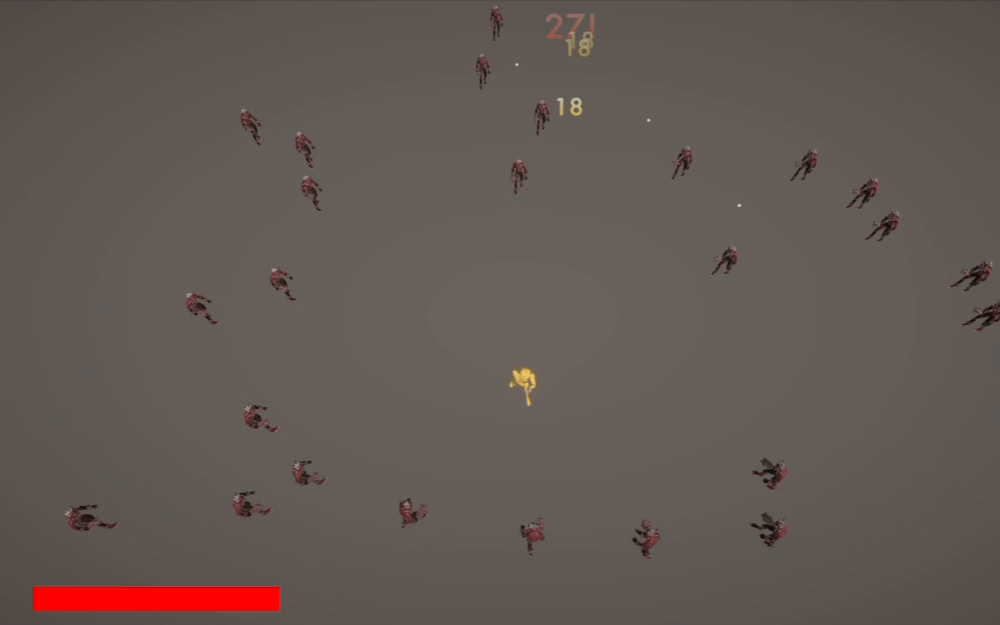
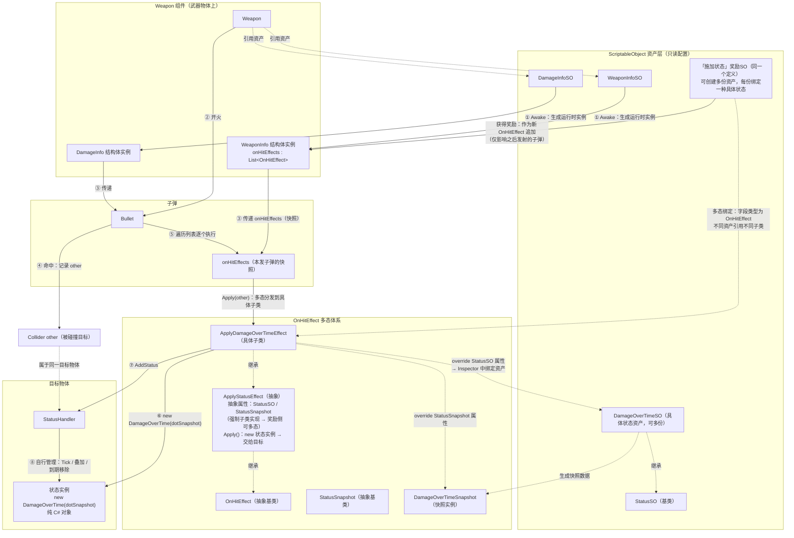
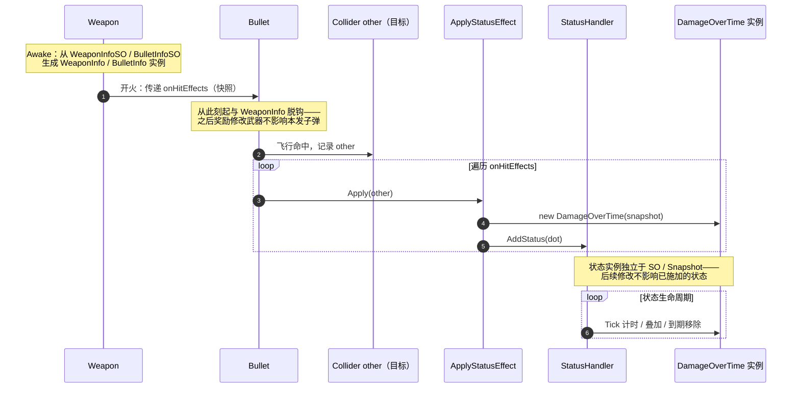

# 《FIRE!》—— 3D Survivor-like Demo

> Unity 2022.3 LTS / C# ｜ 击杀敌人 → 收集经验 → 三选一升级 → 组合 Build 的完整循环

## 试玩
- WebGL试玩 ：[itch.io](https://d0ngguap1.itch.io/fire)
- **Windows 构建包**：[夸克网盘](https://pan.quark.cn/s/c142b1f26f0e)（解压即玩，无需安装 Unity）
- 操作：WASD/方向键 移动，武器自动索敌射击，升级时暂停三选一
- 一局时长约 10 分钟

## 核心系统

### 1. 数据驱动的 On-Hit 效果与状态系统
- On-Hit 效果基于策略模式：`DirectDamage`（直接伤害） / `Execute`（处决）/ `ApplyStatusEffect`（施加状态）
- 通过 `SerializeReference + SubclassSelector` 在 Inspector 中组合配置，一份武器资产可携带任意效果列表
- 状态系统采用 **SO → Snapshot（运行时只读副本）→ Instance** 三段式数据流，
  状态实例为纯 C# 类，由 StatusHandler 集中 Tick，同类型可叠加（canStack / stackLimit）

### 2. ScriptableObject 事件通道与配置
- 击杀、升级、受伤、死亡、获得奖励均通过 Event Channel（SO）广播，
  战斗 / 成长 / 表现层零硬引用
- 配置资产（`EnemyInfoSO` / `WeaponInfoSO`）与运行时实例（`EnemyInfo` / `WeaponInfo`）严格分离，避免编辑器下 SO 数据跨 Play 会话污染
- 深拷贝避坑：`OnHitEffect`实现`Clone()`方法，避免资产与运行时实例持有同一有状态引用

### 3. 敌人 AI
- 状态机逻辑写在 `StateMachineBehaviour` 中（攻击前摇内按 normalizedTime 结算伤害点，Exit 时复位状态），而非堆在 `Update` 里
- 分离力算法实现软性避让：`OverlapSphereNonAlloc` + 静态复用缓冲区，避免实体互相堆叠

### 4. 对象池 + Addressables
- 敌人（Addressables 异步加载，池上限 256）、子弹、伤害飘字（普攻/暴击分池）三种对象池
- 加载失败降级处理、句柄生命周期管理、动画状态 Rebind 重置

### 5. 多态奖励系统
- 奖励侧： `AcquireOnHitEffectRewardSO` 持有并操作 `OnHitEffect` 基类，实现多态性，一个SO脚本可创建多份奖励资产，提高架构可扩展性，利于后续开发填充内容
- 重复获得同类可叠加奖励时提升 `stackLimit` 

### 6. 存档
- Newtonsoft.Json 排行榜存档

## 架构总览
下面的 flowchart 和 sequence diagram 展示了`OnHitEffect` 如何从SO资产中初始化，应用到子弹上并将持续状态类效果施加到目标上。

## 设计决策与权衡

- **为什么用事件通道而不是直接引用**：战斗/成长/表现完全解耦，新增表现层
  （如飘字）无需改动战斗代码。代价是调试时调用栈不直观，靠 Channel 命名规范缓解。
- **为什么 SO 需要运行时副本**：SO 是共享资产，直接修改会在编辑器关闭
  Domain Reload 时跨 Play 残留。所有可变数据在 Spawn/Acquire 时复制。
- **为什么状态用纯 C# 类集中 Tick**：每个 debuff 一个 MonoBehaviour 意味着
  N 个 Update 调用与组件开销；集中遍历一个 List，缓存友好且暂停/死亡清理简单。
- **为什么用 timeScale 暂停**：简单可靠；已知副作用是 scaled time 的 Animator
  会冻结，死亡动画需改用 unscaled time 或在死亡动画播放完成后再修改 timeScale 。

## 性能
- 测试环境：Ryzen 9 7940HX / RTX 4060 Laptop / 1920*1080 / Unity Editor Play Mode
- 同屏 100 敌人稳定 60FPS；同屏 200 敌人 PlayerLoop 稳定小于 16ms 。瓶颈分析：对象池初始化、状态实例 `Tick`、敌人物理计算 `FixedUpdate`
- 手段：对象池、`OverlapSphereNonAlloc`、`Animator Hash`、分离力 O(n·k)

## Roadmap
- 已知的问题：`Addressables` 场景加载健壮性欠缺
- 将输入系统升级到 `Input System`
- 加入音效与粒子特效
- 敌人数量若进一步提升需空间分桶或 Jobs + Burst 改造分离力计算
- 增强存档健壮性、使用文件替换实现原子写入
- 引入技能系统作为升级奖励，内置CD自动释放，采取类似 `StatusHandler` 集中处理 `Tick` 的方式

## 重要的踩坑经历
- **ScriptableObject的资产污染**：仅仅构造快照结构体不可靠，任何引用类型都必须实现深拷贝。如 `WeaponInfoSO.onHitEffects` 本身是一个 `List<OnHitEffect>`，在拷贝时除了自身需要 `new` 以外，表中的内容也需要 `Clone()` 创建新对象。
- **SO 事件通道在内存中的双份实例**：场景/预制体里对 SO 资产的直接引用在打包时会把该资产复制进场景所在的 bundle/依赖里；同一份 SO 又通过 ``Addressables`` 加载时，``Addressables`` 会再实例化一份。结果就是内存里有两个原生对象、两个不同的 InstanceID，事件通道的订阅静默失效，解决方式是将涉及到的场景整体作为 Addressable 资源打包。
- **怪物在行走时变模糊**:摄像机移动在 ``LateUpdate`` 中、怪物移动在 ``FixedUpdate`` 中导致，需要设置刚体的 ``Interpolate = Interpolate``

## 开发环境
Unity 2022.3.62f3c1 / C# 10 / Addressables 1.22.3 / SerializeReference Extensions 1.7.0 /Newtonsoft.Json 3.2.2